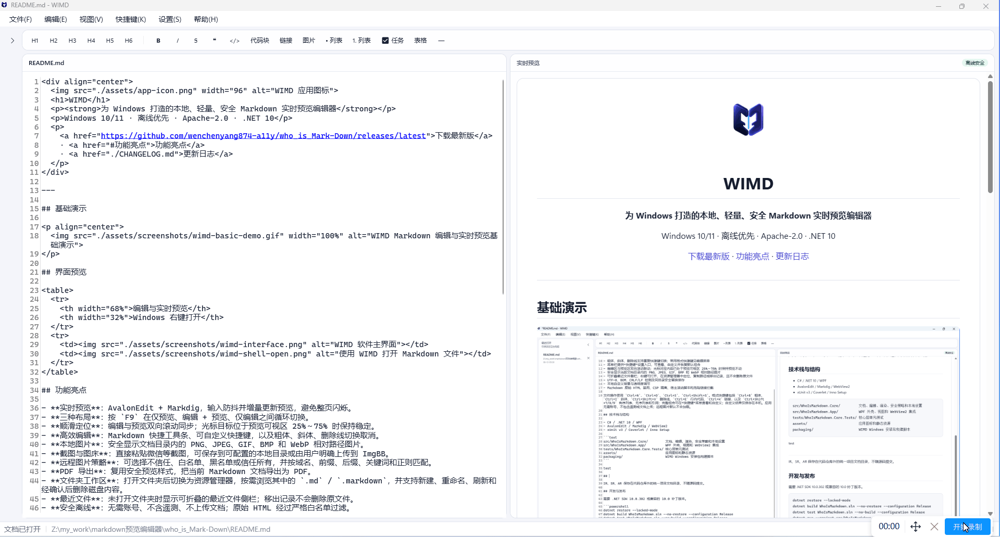
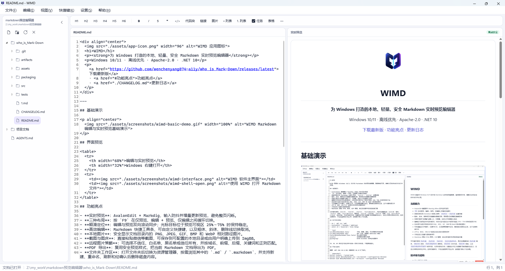
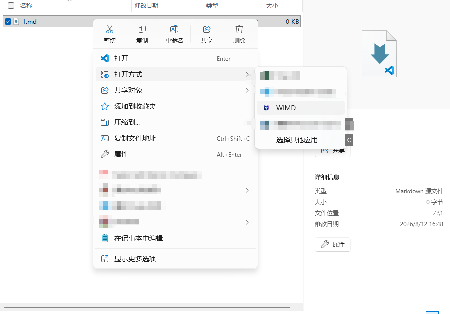

<div align="center">
  
  <h1>WIMD</h1>
  <p><strong>为 Windows 打造的本地、轻量、安全 Markdown 实时预览编辑器</strong></p>
  <p>Windows 10/11 · 离线优先 · Apache-2.0 · .NET 10</p>
  <p>
    <a href="https://github.com/wenchenyang874-a11y/who_is_Mark-Down/releases/latest">下载最新版</a>
    · <a href="#功能亮点">功能亮点</a>
    · <a href="./CHANGELOG.md">更新日志</a>
  </p>
</div>

---

## 基础演示

<p align="center">
  
</p>

## 界面预览

<table>
  <tr>
    <th width="68%">编辑与实时预览</th>
    <th width="32%">Windows 右键打开</th>
  </tr>
  <tr>
    <td></td>
    <td></td>
  </tr>
</table>

## 功能亮点

- **实时预览**：AvalonEdit + Markdig，输入防抖并增量更新预览，避免整页闪烁。
- **三种布局**：按 `F9` 在仅预览、编辑 + 预览、仅编辑之间循环切换。
- **按需预览**：仅编辑模式下暂不启动预览组件，也不随输入渲染隐藏页面；显示预览或导出 PDF 时再按需准备。已初始化的预览保留供切换复用，不会在每次隐藏时销毁。
- **打开时的布局**：在“设置 → 打开文件时的显示模式”选择仅编辑、编辑 + 预览、仅预览或沿用上次模式；默认沿用上次模式，重启后也会记住。更改设置从下次打开文件开始生效，保存和重新加载不会改变当前布局。
- **顺滑定位**：编辑与预览双向滚动同步；光标目标位于预览可视区 25%～75% 时保持稳定。
- **标题折叠**：预览中各级标题左侧提供展开/收起按钮，不挤占标题位置；收起内容直到下一个同级或更高级标题，重新展开父标题时保留子标题的折叠状态。折叠仅影响当前文档的预览，不修改 Markdown，PDF 仍导出完整内容。
- **高效编辑**：Markdown 快捷工具条、可自定义快捷键、粗体/斜体/删除线切换取消，以及可选择行列数的表格插入。
- **预览样式**：通过“设置 → 预览样式...”或有序列表按钮右侧的下拉入口，选择原生简洁、加粗强调、圆形徽标、圆角方标四种编号外观，不改 Markdown 源文。全局默认保存在本机供新窗口使用；当前窗口可单独覆盖或跟随默认，关闭后不保留覆盖。其他已开窗口不实时同步全局变更。
- **交互任务**：已完成任务以绿色显示，可直接在预览区点击复选框并同步修改 Markdown 状态。
- **代码块复制**：预览区代码块右上角提供复制按钮，一键复制纯代码并显示成功或失败反馈。
- **Mermaid 图表**：离线渲染 `mermaid` 围栏中的流程图、时序图等常用图表；单击图表可进入独立查看器缩放、拖动或另存，无需 CDN，语法错误会在原位置显示说明而不会清空预览。
- **图片与 SVG**：支持本地图片、远程 SVG 徽章、SVG data URI 和无后缀图片接口；本地 SVG 原样插入，图片交给浏览器原生显示，不做 SVG 内容过滤。
- **独立图片查看器**：单击无链接的预览图片可在单独窗口中打开；带链接图片显示链接手型，单击打开链接，右键可选择“打开图片”或“打开链接”。查看器可最小化、最大化和拖动窗口，支持滚轮缩放、左键平移、100%、适应窗口，以及可自选原格式、PNG 或 HTML 的安全另存为。再次打开另一张图片时在同一窗口内换图，窗口位置、大小和最大化状态保持不变，打开时默认按适应窗口居中显示。
- **图片另存为格式**：工具栏按钮、查看窗口右键菜单和预览中图片的右键菜单提供同一份格式清单——原格式、PNG 图片和自包含 HTML 网页；HTML 把图片内嵌为 base64，可单独打开和归档。
- **图片快速打开**：独立窗口先响应，图片在后台加载；优先复用预览已收到的远程图片，避免为了放大再下载一次。会话缓存有容量限制，换文档或强制刷新后失效；首次网络加载仍受服务器和网络速度影响。
- **重新加载与外部修改**：`F5` 或“文件 → 重新加载”可重新读取磁盘上的文档并刷新预览，已打开的图片查看窗口也会重新加载它正在显示的那张图；文档被其他程序修改时会提示并可一键重新加载，未保存的修改仍会先经确认。
- **截图与图床**：直接粘贴微信等截图，可保存到可配置的本地目录或由用户明确上传到 ImgBB。
- **远程图片**：默认允许 HTTP/HTTPS 图片链接，不再受旧黑白名单或文件后缀限制。
- **PDF 导出**：复用安全预览样式，把当前 Markdown 文档导出为 PDF。
- **文件夹工作区**：可通过“文件 → 打开文件夹”或 Windows 文件夹右键菜单中的“用 WIMD 打开”进入资源管理器，按需浏览其中的 `.md` / `.markdown`，并支持新建、重命名、刷新、在新窗口中打开和经确认后删除磁盘内容。
- **最近文件**：未打开文件夹时显示可折叠的最近文件侧栏，当前正在编辑的文件以主题色高亮；当前运行期间切换已有记录不会打乱列表，下一次启动时再按最新打开时间排序；可右键在新窗口中打开，移出记录不会删除原文件。
- **快速启动**：启动阶段不逐项探测最近文件，也不在窗口线程同步访问命令行中的文件或文件夹；遇到断开的映射盘、网络位置或响应缓慢的路径时，主窗口仍能及时显示并保持交互。
- **按需渲染**：Markdown 解析器在首次后台渲染时创建；只有包含图表的文档才加载 Mermaid。快速输入会取消排队中的旧解析，未变化的图表使用有容量上限的缓存。
- **局部更新**：缓存未变化语义块的安全过滤结果，普通编辑只更新变化部分，保留其他图片与代码复制控件；原始 HTML 使用完整过滤，`F5` 仍可强制刷新。
- **轻量输入**：通过文档版本跟踪未保存状态，防抖后才获取不可变快照并在后台生成预览文本；保存期间的新修改仍保留为未保存状态。
- **后台交付**：预览页面拼接、正文更新计划和 JSON 序列化在后台串行准备；普通编辑不重建完整页面，过时结果不会提交到当前文档。
- **并行准备**：需要预览时，文件读取与预览初始化重叠执行，Markdown 渲染器在后台与浏览器并行准备；预览、图片查看器和离屏导出复用同配置的环境创建任务，仅编辑模式仍不提前初始化预览。
- **后台设置**：连续修改合并后在后台保存，关闭前等待最后状态落盘；多个窗口修改不同设置时合并保存，减少旧配置互相覆盖。
- **长文与目录**：预览按源行索引定位并合并连续光标请求；工作区按需生成可见树控件、分批呈现条目，关闭或折叠后不应用旧目录结果。
- **安全离线**：无需账号、不含遥测、不上传文档；原始 HTML 经过严格白名单过滤。
- **本地诊断日志**：通过“帮助 → 打开日志文件夹”查看启动、文件读写、预览、图片、工作区、设置、更新与关闭等阶段的耗时和结果。日志保存在 `%LocalAppData%\WIMD\Logs\`，专用后台线程批量写入并自动轮换，记录队列溢出和观察/采样跳过原因，不上传，不记录文档正文、文件路径、图片链接或密钥。
- **异步等待分段**：区分返回任务前的同步派发、任务尚未完成和任务已完成但调用方还未恢复；记录采样完成点与恢复间隔。该间隔是等待下界，不是底层 I/O 的精确完成时刻，也不代表整个操作都在阻塞界面。
- **保存诊断**：细分编码、写入、缓冲刷新、磁盘刷盘、原子替换、文件戳及清理；失败和取消记录对应阶段。该诊断不改变原文件保护与保存确认规则，也不记录文件路径或正文。
- **等待原因诊断**：设置读写区分锁等待与各读写阶段；脚本等待记录原生调用、轮询和间隔耗时，明确超时、失败与取消；渲染排队取消按取消记录。浏览器超时仅停止宿主等待，不保证终止浏览器内部工作。
- **慢操作现场**：操作尚未完成时也会记录线程状态、CPU、构建检查点及内存/I/O/GC/线程池计数；没有操作登记的 UI 无响应也能检测，持续卡顿会限频采集当时的托管方法栈，不上传或保存原始跟踪。采样有开销，不保证捕获短暂卡顿。应用入口之前或内核等待仍需通过“帮助 → 采集启动诊断...”确认后使用 Windows 系统跟踪：以普通权限新开窗口读取当前文件的磁盘版本，不复制或覆盖未保存内容；最长录制 30 秒，合并保存另需时间并需预留磁盘空间。ETL 仅留本地，但可能含路径、命令行及其他进程元数据，分享前须检查。
- **个性背景**：选择本地图片铺满整个应用窗口，标题栏、菜单、侧栏、快捷工具栏、编辑区、预览区和状态栏均可透出背景；代码块与表格使用分层半透明表面维持可读性，背景可见度 0% 为完全隐藏，100% 为最清晰。
- **背景加载**：选择图片后先在后台复制到 `%LocalAppData%\WIMD\Backgrounds\` 并验证，再保存副本路径；移动或删除原图不影响新窗口。按显示尺寸解码（最长边不超过 4096 像素），切换外观时复用图片；不修改或删除背景原文件。旧版本保存的原图路径需重新选择一次才能转为副本。
- **主题与字体**：提供跟随 Windows、明亮、深色和暖色护眼主题；编辑区与预览区可分别设置字号和本机已安装字体，直接在字体下拉框输入中文名或英文名即可筛选。
- **安全更新**：可从“帮助 → 检查更新”查询 GitHub Release；也可自行启用启动检查。下载前会校验正式版本、安装包名称、大小和 SHA-256，安装始终需要用户确认。
- **更新后恢复**：覆盖更新正在运行的 WIMD 时，安装器会先说明关闭与恢复流程；未保存正文只写入本机临时恢复区，完成页默认重新打开并恢复原窗口，正文继续保持未保存状态。该临时恢复只用于安装器触发的关闭；用户平时退出 WIMD 时仍会收到保存、不保存或取消提示。
- **安装诊断**：安装时只对 WIMD 应用入口做占用检测，不将整套运行库加入重复扫描；安装日志保留在 Windows 临时目录，可用于定位准备、关闭和安装阶段的等待，不会上传。
- **性能状态**：底部状态栏每秒显示当前 WIMD 主进程的 CPU 占用和工作集内存，便于观察单个应用实例的资源变化。
- **外部修改处理**：在“设置 → 文件在外部修改时”选择弹窗提醒或自动更新；可为当前文件单独设置，或跟随所有文件的默认行为。有未保存修改时始终询问，不自动覆盖；单文件设置按完整路径保存在本机，不写入 Markdown。

## 快速开始

1. 前往 [Releases](https://github.com/wenchenyang874-a11y/who_is_Mark-Down/releases/latest) 下载最新的 Windows x64 安装包。
2. 运行简体中文安装向导。若检测到已有 WIMD，确认后会在原目录覆盖升级；支持更新恢复的 WIMD 正在运行时，可在安装后重新打开并恢复窗口与未保存内容。
3. 启动 WIMD，通过“文件 → 打开文件夹”或资源管理器中文件夹的“用 WIMD 打开”进入工作区模式，也可以直接打开单个 `.md` / `.markdown` 文件。Windows 11 中该入口可能位于“显示更多选项”。

> WIMD 的核心编辑和本地预览可完全离线运行；打开含远程图片的文档会请求图片服务器。检查更新只会在用户主动操作或明确启用“启动时检查更新”后联网，软件不会静默下载或安装更新。

设置修改会在后台合并保存，正常退出时等待最后一批设置落盘。若保存失败或等待超时，会提示返回重试或仍然退出；未保存的 Markdown 文档仍按原有流程单独确认。

## 常用快捷键

| 功能 | 快捷键 |
| --- | --- |
| 新建 / 打开 / 保存 / 另存为 | `Ctrl+N` / `Ctrl+O` / `Ctrl+S` / `Ctrl+Shift+S` |
| 重新加载文档 | `F5` |
| 一至六级标题 | `Ctrl+1` ～ `Ctrl+6` |
| 粗体 / 斜体 / 删除线 | `Ctrl+B` / `Ctrl+I` / `Ctrl+Shift+X` |
| 行内代码 / 链接 | `Ctrl+E` / `Ctrl+K` |
| 循环切换视图 | `F9` |

完整组合可在应用顶部的“快捷键”菜单中查看、自定义或恢复默认值；冲突组合会被自动拒绝。

## 安全与隐私

- 文档内容只在本机处理，不上传、不遥测。
- 字体只引用 Windows 中已安装的字体；WIMD 不附带、复制、上传或再分发字体文件。
- 更新只访问 WIMD 的 GitHub Release；下载并验证完成后仍需用户确认才会启动安装程序。
- 安装器触发更新关闭时，未保存正文仅短时写入当前 Windows 用户的 WIMD 临时恢复区；不会上传，也不会自动覆盖 Markdown 原文件。
- 打开含远程图片的文档会向图片服务器发出请求；文档正文不会上传。页面脚本、iframe、表单和事件属性仍不可执行。
- 本地、远程和 data URI SVG 均使用浏览器原生 `` 模式，不做 SVG 内容过滤；页面作者脚本与图片模式是不同边界。
- 本地图片只允许来自当前文档目录；最近文件和背景操作不会删除原文件。
- Windows 资源管理器调用使用独立路径参数，不把文件路径拼接为可执行命令。

## 开发

技术栈：C#、.NET 10、WPF、AvalonEdit、Markdig、Mermaid、WebView2、xUnit、Inno Setup。

```powershell
dotnet restore --locked-mode
dotnet build WhoIsMarkdown.sln --no-restore --configuration Release
dotnet test WhoIsMarkdown.sln --no-build --configuration Release
dotnet run --project src/WhoIsMarkdown.App/WhoIsMarkdown.App.csproj
dotnet format WhoIsMarkdown.sln --verify-no-changes
$releaseVersion = Read-Host '请输入三段式版本号（例如 1.2.3）'
./packaging/build-release.ps1 -Version $releaseVersion
```

核心代码位于 `src/`，核心与桌面文档状态测试位于 `tests/`，Windows 安装脚本位于 `packaging/`。IR、SR、AR 保存在仓库外的项目文档目录，不随源码提交。

## 版本与许可

版本变化见 [CHANGELOG.md](./CHANGELOG.md)。本项目采用 [Apache License 2.0](./LICENSE) 开源许可，内置组件的许可信息见 [THIRD-PARTY-NOTICES.md](./THIRD-PARTY-NOTICES.md)。
